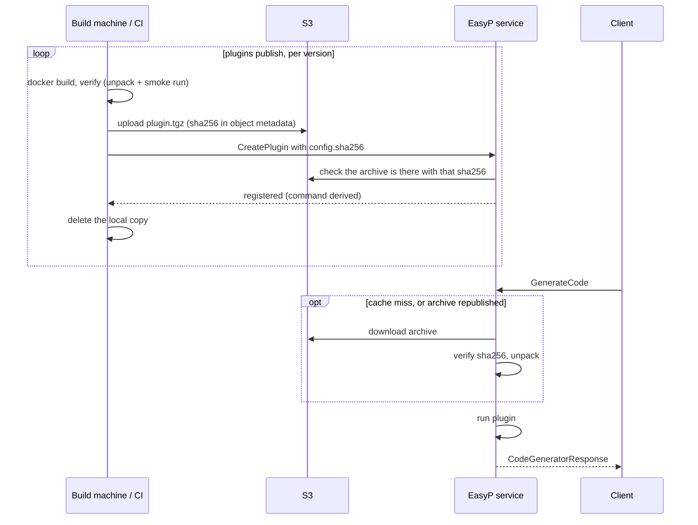

## Names

A plugin is addressed as `group/name:version`, for example
`protocolbuffers/go:v1.36.10`.

- `group` and `name`: lowercase letters, digits and `-`, starting with a letter.
- `version`: `vX.Y` or `vX.Y.Z` (protobuf's own releases are `v33.1`-style), or
  `latest`.

`latest` picks the registered version that sorts last **as a string**. With
`v1.36.9` and `v1.36.10` registered it returns `v1.36.9`. Pin versions in every
configuration that matters.

## The catalogue

The service repository's `registry/` directory holds a build recipe for every
plugin easyp-tech publishes. In v1.0.2 that is **80 plugins that build 1522 distinct versions** (1743 are listed; see the [catalog](/docs/api-service/plugin-catalog) for why)
in ten groups:

| Group | Plugins |
|---|---|
| `protocolbuffers` | 12 |
| `grpc` | 13 |
| `bufbuild` | 15 |
| `connectrpc` | 9 |
| `community` | 23 |
| `grpc-ecosystem` | 2 |
| `apple` | 2 |
| `anthropics` | 2 |
| `googlecloudplatform` | 1 |
| `pluginrpc` | 1 |

Every plugin and version is listed in the [Plugin catalog](/docs/api-service/plugin-catalog),
generated from these files.

The catalogue is a recipe book, not a set of prebuilt artifacts: a deployment
builds and registers the versions it wants. A Community licence allows 10
registered versions in total.

## One plugin directory

<Files>
  <Folder name="registry/grpc/go" defaultOpen>
    <File name="Dockerfile — takes ARG VERSION, produces /plugin" />
    <File name="plugin.yaml — the versions to build" />
  </Folder>
</Files>

```yaml
# registry/protocolbuffers/go/plugin.yaml
build_args:
  GO_MODULE: google.golang.org/protobuf/cmd/protoc-gen-go
versions:
  - v1.36.10
  - v1.36.9
```

Optional keys in `plugin.yaml`: `build_args` (passed to every build),
`dockerfile` (a different file), `args` (arguments for the entrypoint). A
version entry may be a mapping that overrides these for itself or sets
`skip: true`.

### What the Dockerfile must produce

- **An executable at `/plugin`.** It reads a `CodeGeneratorRequest` on stdin,
  writes a `CodeGeneratorResponse` on stdout, and exits non-zero on failure.
- **Anything else it needs next to it.** The whole image filesystem is
  extracted into the version directory and shipped together: a jar, a
  `node_modules`, a shared library.
- **One recipe for every version**, selected by `ARG VERSION`.
- By convention in this repository: a `scratch` or distroless final stage,
  running as `nobody`, base images pinned by digest, static binaries where the
  language allows.

The service does not run the image. Docker is used only at build time to produce
a directory of files; at run time the service executes `plugin` from that
directory as an ordinary process.

## From recipe to runnable plugin



`easyp-svc plugins publish <registry-path>` does the whole thing, one version at
a time, so a catalogue never has to fit on the publishing machine and nothing is
registered before its archive is in place:

1. **build** — a Docker build of the version. Needs Docker. Produces Linux
   binaries.
2. **verify** — the bundle is packed and unpacked with the service's own
   unpacker, and `plugin` is smoke-run in the service's base image. A version
   that fails goes no further.
3. **upload** — `plugin.tgz` goes to storage with its sha256 in the object
   metadata. Skipped when storage already holds the same archive.
4. **register** — `CreatePlugin` (or `UpdatePlugin`, if the service already has
   the version) with the sha256 in the config. The service checks the archive is
   in storage with that checksum and derives the command
   (`{plugins_dir}/{group}/{name}/{version}/plugin`) itself. Needs a write token
   and a v1.2.0 or newer service.
5. **delete** the local copy.

Re-running is safe: a version that is registered and in storage is skipped, one
in storage but not registered is only registered. `plugins build --archive` +
`plugins publish --archives` split building and publishing across machines.

With object storage enabled, a version whose archive is absent cannot be
registered (`FAILED_PRECONDITION` / `BINARY_NOT_UPLOADED`), and one whose stored
archive is not the `sha256` the config names fails with `FAILED_PRECONDITION` /
`CHECKSUM_MISMATCH`. The client can name a checksum, but only the one the stored
archive actually has.

### Republishing a version [#republishing]

`plugins publish --force` rebuilds a version the service already has, uploads
the new archive and replaces the version's config with the new checksum through
`UpdatePlugin`. Every replica then refetches its unpacked copy on next use: each
keeps a `.sha256` marker beside the unpacked directory and compares it with the
registry. Directories unpacked before v1.2.0 have no marker and count as current.
The config `publish` sends is the whole config, so a hand-edited `env` or
`timeout` does not survive republishing.

Overwriting an archive in storage any other way still breaks the version: the
object no longer has the recorded checksum, and the next download fails with
`FAILED_PRECONDITION` / `CHECKSUM_MISMATCH`. Run `publish --force` for it, or
publish the change as a new version.

In **local mode** (no bucket) the files must be present under `plugins_dir` on
the service's disk. On the same host, `plugins publish --plugins-dir <dir>`
unpacks each version there instead of uploading it; given no registry and no
`--archives`, it registers what is already in that directory. Otherwise mount,
copy, or build the files into a derived image, then register them.

All commands and flags: [Operator CLI](/docs/api-service/operator-cli).

## Registered configuration

Each registered version is one row in the `plugins` table. Its `config` is:

```json
{
  "command": ["/plugins/protocolbuffers/go/v1.36.10/plugin"],
  "env": {},
  "timeout": "60s",
  "sha256": "9f2c…"
}
```

| Field | Meaning |
|---|---|
| `command` | Executable and arguments. Optional since v1.2.0: when omitted, the service derives `{plugins_dir}/{group}/{name}/{version}/plugin`. When given — for a plugin that needs arguments — `command[0]` must resolve inside `registry.plugins_dir`, checked at registration and again before each run after resolving symlinks. |
| `env` | The plugin's entire environment. Nothing from the service is inherited. |
| `timeout` | Optional per-plugin limit, applied inside `worker_pool.generation_timeout`. |
| `sha256` | The archive's checksum. When the request names one, registration fails with `CHECKSUM_MISMATCH` unless the stored archive has exactly it; when not, the service records the stored archive's checksum itself. Absent in local mode. |

`UpdatePlugin` takes a field mask (`config`, `tags`); a config update records the
checksum the same way, and a changed `sha256` makes every replica refetch the
archive. `DeletePlugin` removes the row and, with object storage, the archive and
the cached directory.

## Adding a plugin

**To the public catalogue:** add `registry/<group>/<name>/` with a `Dockerfile`
and a `plugin.yaml` — `community/<author>-<tool>` if the project is not one of
the named groups — and open a pull request against
[easyp-tech/service](https://github.com/easyp-tech/service). The repository's
issue templates include a plugin request.

**Only for your deployment:** the same two files in your own directory tree.
`plugins build` takes any registry path, and registration does not care where a
recipe came from. Private plugins never have to be published anywhere.

Before registering a plugin someone else wrote, read
[Security](/docs/api-service/security): the plugin runs with the service's
privileges.

## Relationship to bufbuild/plugins

The group layout and the plugin set follow
[bufbuild/plugins](https://github.com/bufbuild/plugins) (Apache-2.0), the
catalogue behind Buf's remote plugins: the same ten owners, and the same
`community/<author>-<tool>` naming. The recipes are written for this service's
build (one Dockerfile per plugin taking `ARG VERSION`, a `plugin.yaml` version
list, `/plugin` as the entrypoint) rather than copied per version. The two
catalogues are maintained separately and their version lists differ.
