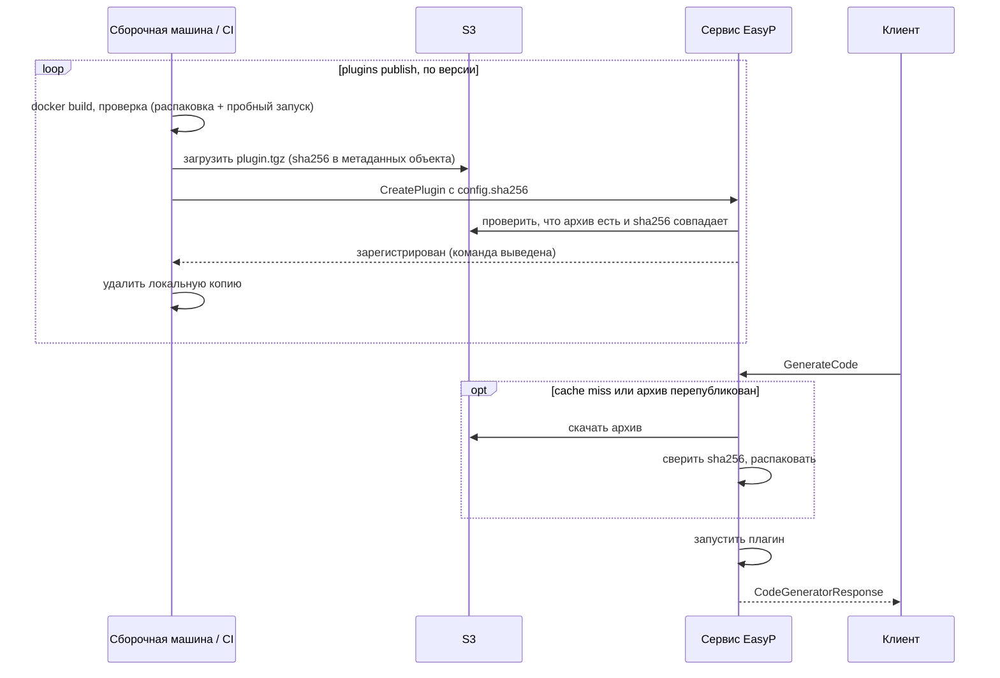

## Имена

Плагин адресуется как `group/name:version`, например
`protocolbuffers/go:v1.36.10`.

- `group` и `name`: строчные латинские буквы, цифры и `-`, начинаются с буквы.
- `version`: `vX.Y` или `vX.Y.Z` (у самого protobuf релизы вида `v33.1`) либо
  `latest`.

`latest` выбирает зарегистрированную версию, которая оказывается последней **при
сравнении строк**. Если зарегистрированы `v1.36.9` и `v1.36.10`, вернётся
`v1.36.9`. Фиксируйте версии во всех конфигурациях, где это важно.

## Каталог

Каталог `registry/` репозитория сервиса содержит рецепт сборки для каждого
плагина, который публикует easyp-tech. В v1.0.2 это **80 плагинов, из которых собирается 1522 различных версии** (перечислено 1743; почему — см. [каталог](/ru/docs/api-service/plugin-catalog))
в десяти группах:

| Группа | Плагинов |
|---|---|
| `protocolbuffers` | 12 |
| `grpc` | 13 |
| `bufbuild` | 15 |
| `connectrpc` | 9 |
| `community` | 23 |
| `grpc-ecosystem` | 2 |
| `apple` | 2 |
| `anthropics` | 2 |
| `googlecloudplatform` | 1 |
| `pluginrpc` | 1 |

Все плагины и версии перечислены в [Каталоге плагинов](/ru/docs/api-service/plugin-catalog),
который генерируется из этих файлов.

Каталог — это книга рецептов, а не набор готовых артефактов: каждое
развёртывание само собирает и регистрирует нужные ему версии. Лицензия Community
допускает всего 10 зарегистрированных версий.

## Каталог одного плагина

<Files>
  <Folder name="registry/grpc/go" defaultOpen>
    <File name="Dockerfile — принимает ARG VERSION, собирает /plugin" />
    <File name="plugin.yaml — какие версии собирать" />
  </Folder>
</Files>

```yaml
# registry/protocolbuffers/go/plugin.yaml
build_args:
  GO_MODULE: google.golang.org/protobuf/cmd/protoc-gen-go
versions:
  - v1.36.10
  - v1.36.9
```

Необязательные ключи `plugin.yaml`: `build_args` (передаются в каждую сборку),
`dockerfile` (другой файл), `args` (аргументы entrypoint). Элемент версии может
быть отображением, которое переопределяет их для себя или задаёт `skip: true`.

### Что должен собрать Dockerfile

- **Исполняемый файл `/plugin`.** Читает `CodeGeneratorRequest` из stdin, пишет
  `CodeGeneratorResponse` в stdout и завершается с ненулевым кодом при ошибке.
- **Всё, что ему нужно, рядом.** Вся файловая система образа распаковывается в
  каталог версии и поставляется вместе: jar, `node_modules`, разделяемая
  библиотека.
- **Один рецепт на все версии**, версия выбирается через `ARG VERSION`.
- По соглашению в этом репозитории: финальная стадия `scratch` или distroless,
  запуск от `nobody`, базовые образы по digest, статические бинарники там, где
  язык позволяет.

Сервис не запускает образ. Docker нужен только при сборке, чтобы получить каталог
с файлами; во время работы сервис запускает `plugin` из этого каталога как
обычный процесс.

## От рецепта до работающего плагина



`easyp-svc plugins publish <registry-path>` делает всё целиком, по одной версии
за раз, так что каталог никогда не обязан помещаться на публикующей машине и
ничего не регистрируется раньше, чем его архив окажется на месте:

1. **build** — Docker-сборка версии. Нужен Docker. Получаются линуксовые
   бинарники.
2. **verify** — бандл упаковывается и распаковывается распаковщиком самого
   сервиса, а `plugin` пробно запускается в базовом образе сервиса. Версия, не
   прошедшая проверку, дальше не идёт.
3. **upload** — `plugin.tgz` загружается в хранилище с sha256 в метаданных
   объекта. Пропускается, если в хранилище уже тот же архив.
4. **register** — `CreatePlugin` (или `UpdatePlugin`, если версия у сервиса уже
   есть) с sha256 в конфиге. Сервис проверяет, что архив лежит в хранилище с этой
   контрольной суммой, и сам выводит команду
   (`{plugins_dir}/{group}/{name}/{version}/plugin`). Нужны токен записи и сервис
   v1.2.0 или новее.
5. **delete** — локальная копия удаляется.

Повторный запуск безопасен: версия, которая зарегистрирована и лежит в
хранилище, пропускается; лежащая в хранилище, но не зарегистрированная — только
регистрируется. `plugins build --archive` + `plugins publish --archives`
позволяют собирать и публиковать на разных машинах.

С включённым объектным хранилищем версию без архива зарегистрировать нельзя
(`FAILED_PRECONDITION` / `BINARY_NOT_UPLOADED`), а версия, чей архив в хранилище
не совпадает с `sha256` из конфига, падает с `FAILED_PRECONDITION` /
`CHECKSUM_MISMATCH`. Клиент может назвать контрольную сумму, но только ту,
которая действительно у архива в хранилище.

### Повторная публикация версии [#republishing]

`plugins publish --force` пересобирает версию, которая у сервиса уже есть,
загружает новый архив и заменяет конфиг версии новой контрольной суммой через
`UpdatePlugin`. После этого каждая реплика при следующем обращении заново
скачивает распакованную копию: рядом с распакованным каталогом каждая хранит
маркер `.sha256` и сверяет его с реестром. Каталоги, распакованные до v1.2.0,
маркера не имеют и считаются актуальными. `publish` отправляет конфиг целиком,
поэтому вручную изменённые `env` или `timeout` повторную публикацию не
переживают.

Перезапись архива в хранилище любым другим способом по-прежнему ломает версию:
у объекта уже не та контрольная сумма, что записана, и следующее скачивание
падает с `FAILED_PRECONDITION` / `CHECKSUM_MISMATCH`. Запустите для неё
`publish --force` или выпустите изменение новой версией.

В **локальном режиме** (без бакета) файлы должны лежать в `plugins_dir` на диске
сервиса. На той же машине `plugins publish --plugins-dir <dir>` распаковывает
туда каждую версию вместо загрузки; без реестра и без `--archives` регистрирует
то, что в этом каталоге уже есть. Иначе смонтируйте файлы, скопируйте или вшейте
в производный образ, а затем зарегистрируйте.

Все команды и флаги — в [CLI оператора](/ru/docs/api-service/operator-cli).

## Зарегистрированная конфигурация [#registered-configuration]

Каждая зарегистрированная версия — одна строка таблицы `plugins`. Её `config`:

```json
{
  "command": ["/plugins/protocolbuffers/go/v1.36.10/plugin"],
  "env": {},
  "timeout": "60s",
  "sha256": "9f2c…"
}
```

| Поле | Смысл |
|---|---|
| `command` | Исполняемый файл и аргументы. С v1.2.0 необязателен: если не задан, сервис выводит `{plugins_dir}/{group}/{name}/{version}/plugin`. Если задан — для плагина, которому нужны аргументы, — `command[0]` должен разрешаться внутрь `registry.plugins_dir`; проверяется при регистрации и повторно перед каждым запуском после разрешения симлинков. |
| `env` | Всё окружение плагина. От сервиса ничего не наследуется. |
| `timeout` | Необязательный лимит плагина внутри `worker_pool.generation_timeout`. |
| `sha256` | Контрольная сумма архива. Если запрос её указывает, регистрация падает с `CHECKSUM_MISMATCH`, если у архива в хранилище не ровно она; если нет — сервис сам записывает сумму архива из хранилища. В локальном режиме отсутствует. |

`UpdatePlugin` принимает маску полей (`config`, `tags`); изменение конфига
записывает контрольную сумму так же, а изменившийся `sha256` заставляет каждую
реплику заново скачать архив. `DeletePlugin` удаляет строку и, при объектном
хранилище, архив и закешированный каталог.

## Добавление плагина [#adding-a-plugin]

**В публичный каталог:** добавьте `registry/<group>/<name>/` с `Dockerfile` и
`plugin.yaml` — в `community/<author>-<tool>`, если проект не относится к одной
из именованных групп, — и откройте pull request в
[easyp-tech/service](https://github.com/easyp-tech/service). Среди шаблонов
issue в репозитории есть запрос плагина.

**Только для своего развёртывания:** те же два файла в своём дереве каталогов.
`plugins build` принимает любой путь к реестру, а регистрации всё равно, откуда
взят рецепт. Приватные плагины не нужно никуда публиковать.

Прежде чем регистрировать плагин, написанный кем-то другим, прочитайте
[Безопасность](/ru/docs/api-service/security): плагин работает с привилегиями
сервиса.

## Связь с bufbuild/plugins

Раскладка по группам и набор плагинов повторяют
[bufbuild/plugins](https://github.com/bufbuild/plugins) (Apache-2.0) — каталог,
на котором построены remote plugins Buf: те же десять владельцев и то же
именование `community/<author>-<tool>`. Рецепты написаны под сборку этого сервиса
(один Dockerfile на плагин с `ARG VERSION`, список версий в `plugin.yaml`,
entrypoint `/plugin`), а не скопированы по версиям. Каталоги сопровождаются
отдельно, и списки версий в них различаются.
